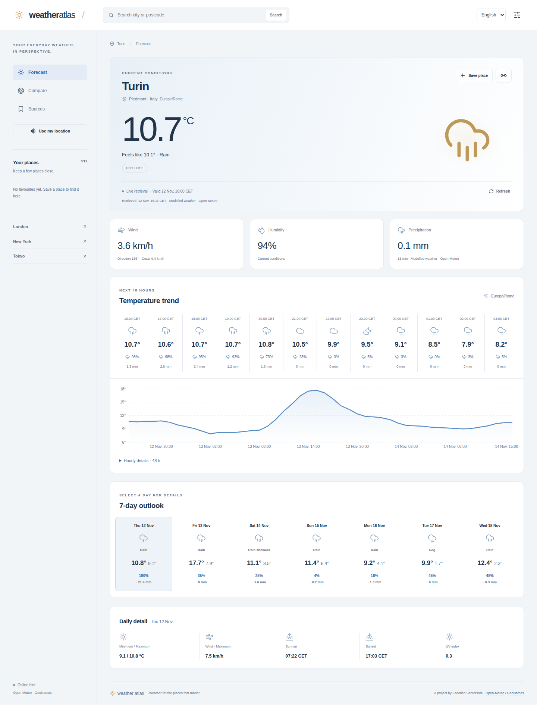
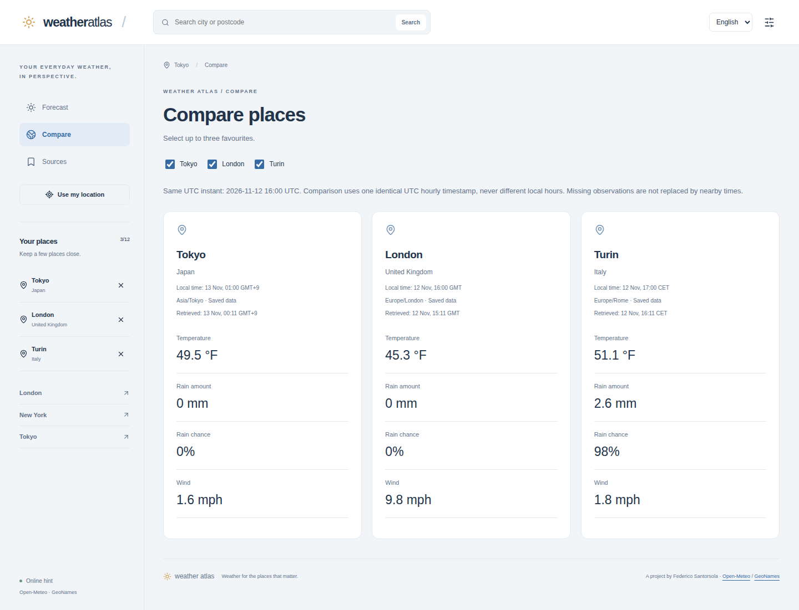
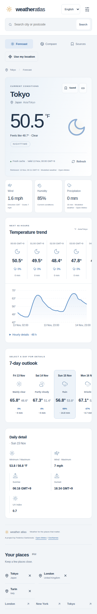

# Weather Atlas

A bilingual weather PWA built with **React, TypeScript and Vite**. Explore current modelled conditions, the next 48 hours and a seven-day outlook, save places and compare forecasts at the same UTC instant.

Weather Atlas defaults to **English**, with an **Italian** option. It runs without an API key and retains previously retrieved forecasts for offline use after a complete first online visit.



## Project overview

- Worldwide place search with region, country and coordinates to distinguish matching names; keyboard-accessible search results.
- Explicit **Use my location** action, with permission, timeout and unavailable-position feedback. Coordinates remain usable without reverse geocoding.
- Current temperature, apparent temperature, condition, humidity, wind speed/direction/gusts, precipitation and day/night status.
- Hourly temperature chart and text table for the next 48 hours, keeping precipitation probability (%) separate from quantity (mm).
- Seven daily forecasts with selectable detail: minimum/maximum, wind maximum, sunrise, sunset and UV index.
- Up to 12 local favourites and comparisons of up to three saved places.
- English/Italian, Celsius/Fahrenheit, km/h/mph/m/s and system/light/dark theme preferences.
- Shareable location, view, selected day and language; browser-local settings and favourites.
- Scope-specific offline app shell, forecast persistence, stale-data labels and an explicit application-update action.

## Interface previews

### Compare places



### Mobile forecast

<p align="center"></p>

Screenshots show the running application with actual Open-Meteo responses, not design mockups.

## Technology and architecture

| Area        | Technology                                 | Responsibility                                              |
| ----------- | ------------------------------------------ | ----------------------------------------------------------- |
| Interface   | React 18, TypeScript, Lucide               | Responsive components and bilingual weather presentation    |
| Charts      | Recharts                                   | Temperature chart with explicit units and table alternative |
| Build       | Vite                                       | Development, static builds and configurable base path       |
| Data        | Open-Meteo Forecast and Geocoding APIs     | Numerical weather forecasts and location search             |
| Persistence | localStorage, bounded in-memory fallback   | Preferences, favourites and up to eight forecast snapshots  |
| PWA         | Service worker generated from build assets | Scoped precache, offline navigation and prompted updates    |
| Checks      | Vitest, Playwright, ESLint, TypeScript     | Data, time, persistence and browser verification            |

```text
Open-Meteo APIs
      │ validated canonical units + Unix timestamps
      ▼
Forecast repository ── 15-minute cache / eight visited places
      │
      ├── current conditions, hourly chart and seven-day detail
      ├── comparison at one exact UTC instant
      └── local preferences, favourites and shareable URLs

Vite production build ── scoped service worker ── offline app shell
```

## Requirements and local startup

Use **Node.js 22.22.1 or newer** and npm. `.nvmrc` records the tested version. No credentials are required for the provider’s free non-commercial endpoints.

From the application directory:

```bash
npm ci
npm run dev
```

Open **http://localhost:3018**. Vite prints an alternative port if it is occupied. To choose a port, use `npm run dev -- --port 3020`.

Turin is the initial suggested location unless a valid URL or previously selected location is available. Geolocation is never requested automatically.

## Using Weather Atlas

1. Search for a city or postcode and choose a specific region/country result, or use the location button.
2. Save the place, explore the hourly table and select a day in the weekly outlook.
3. Open **Preferences** to change units or theme; the language selector remains in the header.
4. Save additional places and open **Compare**. Each card refers to the same UTC hour and displays its corresponding local time.
5. Use **Share** to copy the current view. Explicit `lang=en` or `lang=it` in a URL overrides the stored language; otherwise the saved preference wins, then English.

Search uses the selected language where supported by the geocoding provider. Place names saved in favourites remain the names returned when selected. The language switch does not delete favourites or change coordinates.

## Data and time semantics

[Open-Meteo Forecast API](https://open-meteo.com/en/docs) provides **numerical model estimates**, not a local station reading. Current conditions derive from 15-minute model data; the response interval is displayed. Hourly precipitation covers the preceding hour. Daily precipitation is a sum, while probability is a percentage; the two are never placed on a shared ambiguous axis.

The application requests Celsius, km/h and mm and performs reversible presentation conversions locally. Missing data remains `null` and is displayed as `—` rather than zero. Unknown WMO codes have an explicit fallback.

Forecasts use `timezone=auto` and `timeformat=unixtime`. Validity time, retrieval time and location timezone are displayed separately. Clock labels use the returned IANA timezone, including DST transitions. The provider documents fixed retrieval-offset daily boundaries: daily date labels preserve these boundaries rather than reinterpreting them in the device timezone. Sunrise and sunset are formatted as actual instants in the location timezone.

Comparison selects the next whole UTC hourly instant across all places. It does not match different local hours or substitute nearby observations when an exact timestamp is absent.

## Requests and persistence

- Eight-second request timeout and at most one retry for transient/network failures; no retries for HTTP 4xx responses such as rate limits.
- Abort controllers and request-generation guards prevent obsolete search and forecast responses from replacing a newer selection.
- Successful forecasts expire after **15 minutes** and up to **eight visited places** are retained, ordered by retrieval. Fresh entries are reused across views and comparisons.
- Manual refresh bypasses freshness. There is no continuous network polling. Returning online rechecks the active selection, reusing a fresh cache or fetching an expired entry.
- `navigator.onLine` is a connection hint only. Actual API failures determine fallback behaviour, including on nominally online connections.
- Browser storage failures are reported; an in-memory fallback supports the current session, without promising persistence across reloads.

## Offline PWA and updates

Build and serve the production version to test the service worker:

```bash
npm run build
npm run preview
```

Stop the development server first if it uses the same port. The production output is `dist/`. Use HTTPS in deployment, or localhost during development; opening the HTML with `file://` is unsupported.

After a complete online visit, the app shell can reopen offline and display forecasts for visited locations. Offline data is **not a new forecast**: cache age, retrieval time and validity remain visible. Expired entries can be read, with a separate warning once their forecast period has passed. Unvisited places require connectivity, and geocoding search has no offline search index.

The install button appears only when the browser supplies an install-prompt event. Other browsers have menu-based instructions on the Sources page, including iOS Share → Add to Home Screen. Actual installation UI depends on the browser and platform.

Updates are installed in the background but activated only through **Update now**. Forecasts and preferences live outside the app-shell cache. The worker deletes only Weather Atlas caches for its own scope. At the former root scope it also removes the specifically named legacy `fs-meteo16-*` caches on activation; it never deletes caches of unrelated applications. The worker filename retains `serviceworker.js` to replace the former registration cleanly. Old location coordinates can be migrated, but the former current-only snapshot is not misrepresented as a complete forecast.

## Tests and checks

```bash
npm run typecheck
npm run lint
npm test
npm run build
```

With the production preview running in a second terminal:

```bash
npx playwright install chromium
npm test -- --browser
```

For an additional subpath verification, use `npm test -- --browser --url=http://localhost:3019/weather-atlas/ --dist=/tmp/weather-atlas-prefix` with that production output served by the preview.

The browser script uses `/usr/bin/google-chrome` if available, otherwise Playwright Chromium. `CHROME_PATH` selects another browser executable. Use `--url=http://localhost:3018/` to select the preview address. `npm test -- --all --browser` runs the complete local pipeline with the preview already running.

Tests cover real-response normalisation, malformed/partial data, geocoding, weather codes, translations, units, local dates, DST, stale responses, cache expiry, storage failures, favourites, preferences and URL selections. Fixtures under `src/__fixtures__/` are explicitly test inputs and are not loaded by the production app. The live API is checked separately.

Results and remaining verification limits are recorded in [docs/VERIFICATION.md](docs/VERIFICATION.md). GitHub Actions runs clean installation, typecheck, lint, tests and build; it does not deploy.

## Static hosting and GitHub Pages

Publish the contents of `dist/`. To host under a repository prefix:

```bash
BASE_PATH=/weather-atlas/ npm run build
npm run preview -- --base=/weather-atlas/
```

The default prefix is `/`. Manifest URLs, asset paths, worker scope, offline navigation and scoped cache names follow the configured base path. Navigation state uses query parameters, so server-side SPA route rewrites are unnecessary.

The generated worker precaches build assets and carries a content-derived revision. Do not edit generated files for ordinary releases. No remote repository, deployment or demo URL is created by this local preparation.

## Repository structure

```text
src/
  api.ts             Request URLs, response validation and normalisation
  types.ts           Forecast, location and preference types
  time.ts            UTC/timezone formatting and unit conversions
  storage.ts         Bounded cache, preferences and favourites
  repository.ts      Cache policy and network fallback
  state.ts           Validated URL selection and legacy location migration
  i18n.ts            Central English / Italian translation catalogue
  weather.tsx        WMO descriptions and consistent weather icons
  App.tsx            Navigation, search, current conditions and comparison
  Forecast.tsx       Hourly chart/table and weekly detail
  pwa.ts             Registration, install/update lifecycle helpers
  core.test.ts       Unit and data-contract checks
scripts/
  serviceworker.js   Scope-safe worker template
  browser-check.mjs  Production PWA and UI checks
  test.mjs           Reproducible check runner
public/              PWA icons and development manifest
vite.config.ts       Build configuration and worker/manifest generation
docs/                Real screenshots and verification notes
```

## Provider terms and scope

The [free Open-Meteo API](https://open-meteo.com/en/terms) is for **non-commercial use**, with limits below 10,000 requests/day, 5,000/hour and 600/minute. Service availability is not guaranteed. The CC BY 4.0 data licence does not imply unrestricted commercial access to the free service; commercial deployment requires appropriate provider arrangements.

Weather data is attributed to [Open-Meteo](https://open-meteo.com/) and geocoding to [GeoNames](https://www.geonames.org/). See [ATTRIBUTIONS.md](ATTRIBUTIONS.md) for adaptation notes and dependency rights. No project-wide open-source licence is assigned to the application code.

This release intentionally excludes accounts, databases, push notifications, radar, air quality, pollen, climate history and outdoor planning. It is a portfolio weather explorer, not a safety-critical alert service.

## Author

[Federico Santorsola](https://github.com/Frero0)
